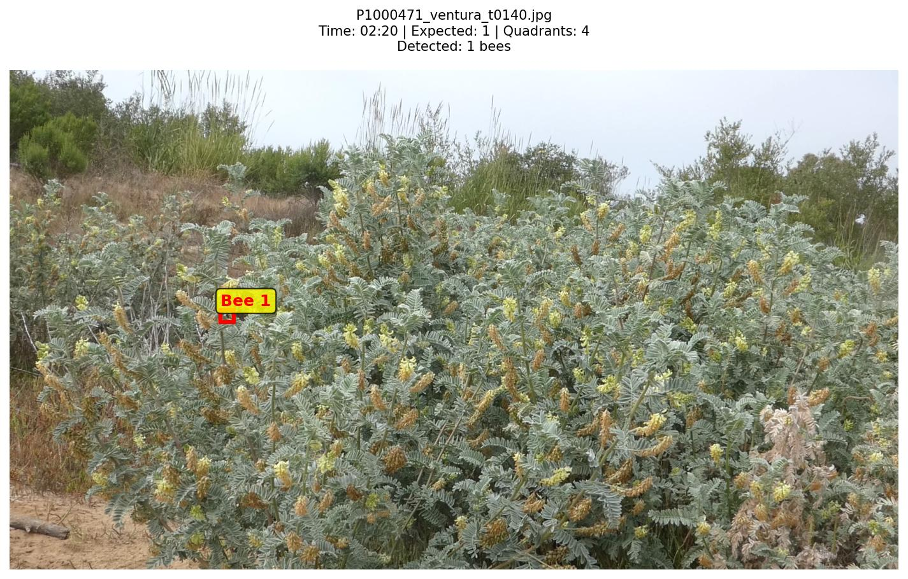
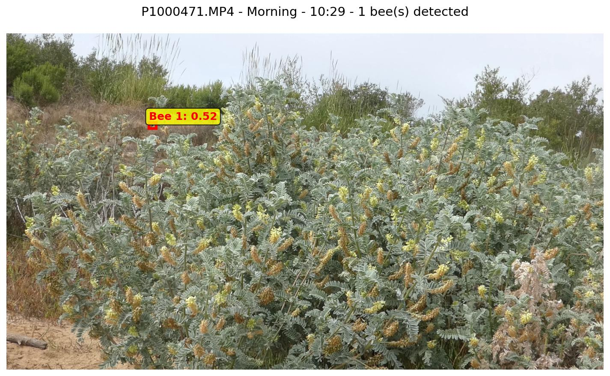
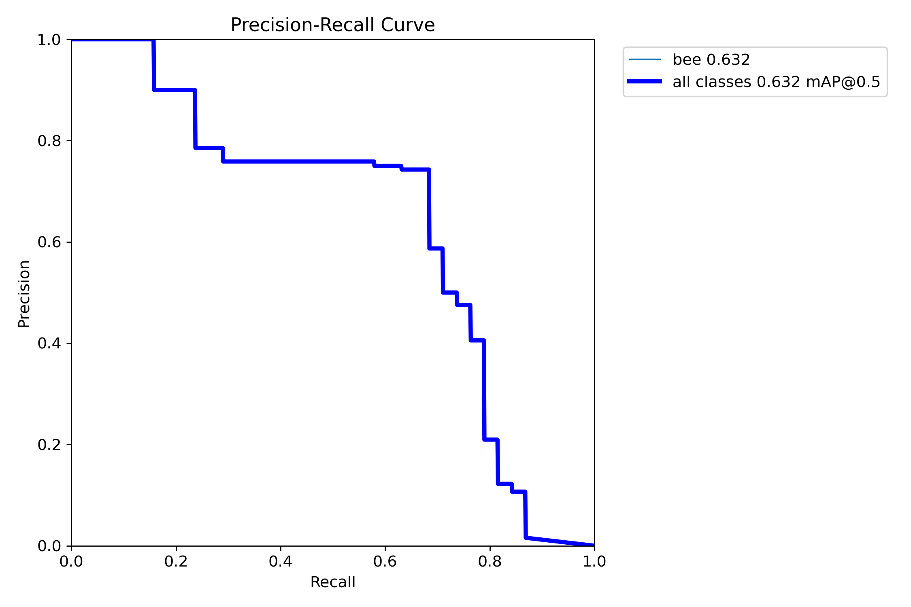
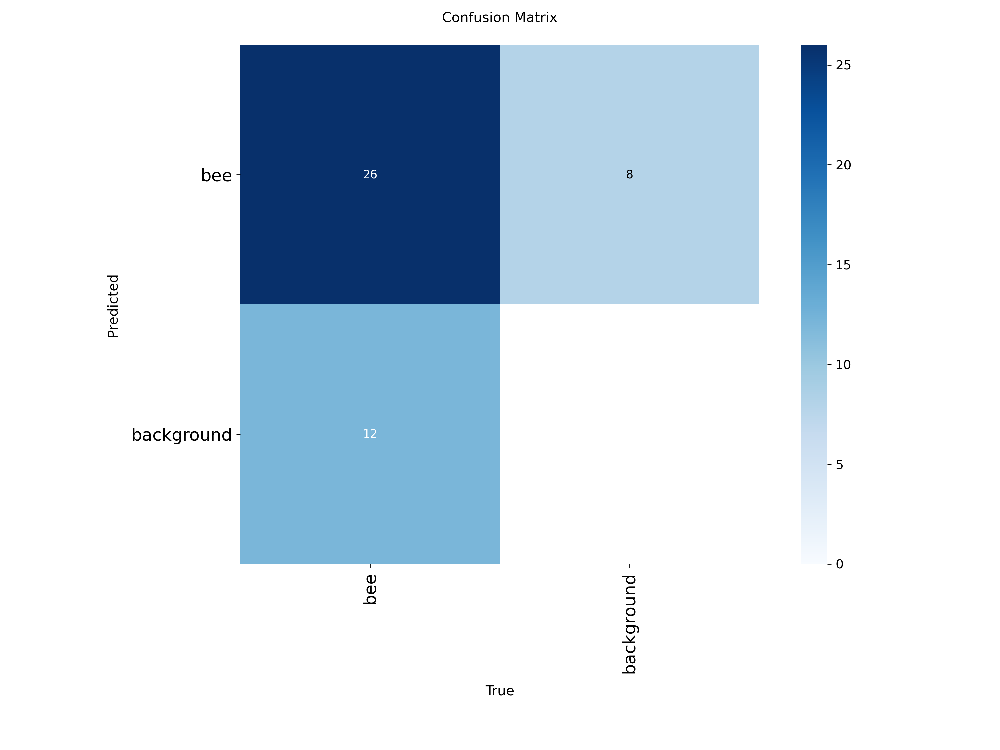

# Automated pollinator detection for rare California coastal plants

A YOLOv8 detection pipeline for finding bumblebee visitors to two federally
endangered plant species in camera-trap video, built from a 2025 field season at the
UC Santa Barbara Cheadle Center's North Campus Open Space (NCOS) restoration site.

---

## The question

Pollinator visitation is central to the persistence of rare plants, but it is very
hard to measure. Direct human observation does not scale: it is weather-dependent,
labour-intensive, and misses the short interactions that matter most. Camera traps
solve the recording problem and create a new one — a season of monitoring yields more
footage than anyone can watch.

Computer vision is the obvious answer, and it runs into its own bottleneck almost
immediately. Training a detector requires someone to draw boxes around bees, frame by
frame. This project took approximately **seven hours of manual annotation across two
passes**, including frames later excluded from the final dataset — against roughly
**200 hours of footage** collected in a single season. Annotation, not modelling, is
what limits ecological computer vision.

That motivates the question this project was built to answer: **can synthetically
generated training data — bumblebee cutouts composited onto real vegetation stills,
with bounding boxes derived automatically from the compositing step — substitute for
manual annotation?** If it can, the bottleneck largely disappears.

**Status: the synthetic comparison has not been run.** This repository contains the
complete manual-annotation pipeline and a detection model trained on hand-drawn
boxes. The synthetic arm is designed but not implemented; no synthetic data was
generated and no synthetic model was trained. Nothing in this repository reports a
manual-versus-synthetic result, because no such result exists yet.

**Please read [`docs/limitations.md`](docs/limitations.md) before citing any number
here.** It documents a split-overlap problem in the originally reported metric and
explains what the current evaluation does and does not establish.

## Species and site

| | |
|---|---|
| **Ventura marsh milk-vetch** | *Astragalus pycnostachyus* var. *lanosissimus* — federally endangered |
| **Salt marsh bird's-beak** | *Chloropyron maritimum* ssp. *maritimum* — federally endangered |
| **Site** | North Campus Open Space (NCOS) restoration area, Goleta, California |
| **Season** | June–September 2025, nine weeks |
| **Primary visitors** | *Bombus* spp., including *B. vosnesenskii* |

Precise coordinates are withheld; site-level identifiers are not georeferenced.

## Results

**Detection performance on a temporal holdout** — a disjoint block of the source
video the model never saw, with a buffer so no evaluation frame sits within ~30 s of a
training frame:

| Split | Frames / boxes | mAP50 | mAP50-95 | Precision | Recall |
|---|---|---|---|---|---|
| **Validation** | 23 / 38 | **0.632** | **0.236** | 0.735 | 0.684 |
| Test | 11 / 11 | 0.439 | 0.175 | 0.927 | 0.364 |

yolov8s, trained from COCO weights on 79 frames, early-stopped at epoch 72 of 150
(best epoch 42). The evaluation set is small, so this is an order-of-magnitude check
that the detector works on unseen frames — not a precise accuracy figure. See
[`docs/limitations.md`](docs/limitations.md).

> **An earlier figure for this work — mAP50 0.745, mAP50-95 0.312 — is a training-fit
> score, not held-out performance.** It was measured on a split in which 53 of 57
> validation frames and 34 of 35 test frames were also in the training set. It is
> retained in the results table for provenance and clearly labelled. The 0.632 above is
> the figure to cite.
>
> **0.632 is not "0.745 corrected."** The two runs differ in two ways at once: the
> leakage was removed, *and* the temporal holdout leaves a 79-frame training set where
> the original had 122 — a 35% reduction. Both changes push the score down, and this
> experiment cannot separate them. See
> [`docs/limitations.md`](docs/limitations.md) §4.

Full table for all six training runs, including the earlier runs measured on the
overlapping split: [`results/metrics/summary_table.md`](results/metrics/summary_table.md).

**Detector output on field video** (v2 checkpoint, confidence ≥ 0.4, 6 videos): 67
frames with at least one detection, 89 individual bee detections, mean confidence
0.387 (range 0.251–0.766), mean 1.33 bees per detection frame, maximum 4. These are
descriptive counts, not accuracy measurements.

<table>
<tr>
<td width="50%"><br><em>Manual annotation. Bees occupy roughly 1–2% of frame width.</em></td>
<td width="50%"><br><em>Model detection on field footage at the 0.4 confidence threshold.</em></td>
</tr>
<tr>
<td width="50%"><br><em>Precision–recall on the temporal holdout validation set (23 frames, 38 boxes).</em></td>
<td width="50%"><br><em>Confusion matrix for the same evaluation.</em></td>
</tr>
</table>

## Field methods in brief

Nine weeks, June–September 2025. **Four sites** within the restoration area, each
marked with coloured yarn so the camera frame stayed consistent between sessions.
**Three days per week, three shifts per day** — morning, mid-day, afternoon — for
roughly three hours of footage daily and about **200 hours** across the season. Site
order was **randomised** each session so that time of day was not confounded with
site. Two Panasonic Lumix cameras per shift, positioned a short distance from the
quadrant and angled downward to catch bees above the canopy, plus a long-duration
camera left in place from morning to afternoon.

Every session was logged by hand: date, week, site, camera, start and end time,
weather, wind speed and direction, observed pollinator activity, duration, and notes.
That log — 86 rows, covering both species — is the human ground truth for this work
and is included at [`docs/field_log.csv`](docs/field_log.csv).

Full protocol: [`docs/methods.md`](docs/methods.md).

## Annotation methods

**Manual (implemented).** Frames were extracted at 1–2 second intervals with OpenCV.
The observation log records which cell of a 3×3 grid held a bee at each timestamp,
which seeds a placeholder box marking frames that need attention; placeholders are
never trained on. Each flagged frame was then opened in a Matplotlib GUI and the
placeholder replaced with a tightly drawn box. The result is **126 annotated frames
containing 157 boxes**, single class `bee`. Every label was rendered back onto its
frame and reviewed by eye.

**Splitting.** All annotated frames come from one continuous 21-minute recording
sampled every 1–2 seconds, so a shuffled split puts near-duplicate frames on both
sides and produces an optimistic score. The evaluation split is therefore **temporal**
— contiguous blocks ordered by position in the video, with a buffer discarded between
them so no evaluation frame lies within ~30 seconds of a training frame:

| Split | Range in source video | Frames |
|---|---|---|
| Train | 00:26 – 16:12 | 79 |
| *buffer — 35 s discarded* | | |
| Validation | 16:47 – 18:31 | 23 |
| *buffer — 41 s discarded* | | |
| Test | 19:12 – 21:02 | 11 |

113 of 126 frames retained; 13 fall in the buffers. Exact frame lists:
[`configs/split_temporal.json`](configs/split_temporal.json).

**Synthetic (planned, not implemented).** The intended approach composites
high-resolution bumblebee cutouts onto unoccupied vegetation stills drawn from the
same footage, randomising position, scale, and rotation, and deriving each bounding
box directly from the compositing transform so no manual drawing is required. This
has not been built or evaluated. See [`docs/limitations.md`](docs/limitations.md).

## Repository structure

```
├── README.md
├── LICENSE                     MIT
├── CITATION.cff
├── requirements.txt            pinned to the environment the model was trained in
├── configs/
│   ├── dataset.yaml            YOLO dataset definition, relative paths
│   ├── train_v2.yaml           hyperparameters of the published run
│   └── split_temporal.json     exact temporal holdout: cuts, buffers, frame lists
├── src/
│   ├── extract_frames.py       1. sample frames, seed placeholder labels
│   ├── annotate.py             2. Matplotlib GUI, draw real boxes (resumable)
│   ├── visualize_annotations.py 3. render overlays for visual QA
│   ├── train_model.py          4. train YOLOv8
│   ├── evaluate.py             5. run detector over field video
│   ├── verify_detections.py    6. confidence-threshold review
│   ├── compile_detections.py   6. annotated frames + per-box metadata
│   ├── track_hydat.py          hybrid detection + tracking → visitation events
│   └── track_hydat_lowres.py   tracking variant with low-res pass
├── results/
│   ├── metrics/                per-epoch logs (7 runs), summary table, detection stats
│   ├── curves/                 PR / F1 / confusion matrix for the temporal-holdout run
│   ├── detections/             12 sample detection frames
│   └── figures/                annotation overlays, training summary
├── models/                     published v2 checkpoint (21 MB)
├── data/README.md              dataset description, provenance, Zenodo manifest
└── docs/
    ├── methods.md              full field and annotation protocol
    ├── limitations.md          what the numbers do and do not establish
    └── field_log.csv           86-row hand-kept session log
```

## Reproducing

```bash
git clone https://github.com/katerinabischell/bee-monitoring-ml.git
cd bee-monitoring-ml
python3.11 -m venv .venv && source .venv/bin/activate
pip install -r requirements.txt
```

The image data is not in this repository. Download the frame archive from the Zenodo
deposit and unpack it to `data/yolo_dataset/`, so that `train/images`, `val/images`,
and `test/images` sit where `configs/dataset.yaml` expects them. See
[`data/README.md`](data/README.md).

Retrain the detector:

```bash
python src/train_model.py --data-dir data --weights yolov8s.pt --epochs 150
```

Run the trained detector over video. Raw footage is not distributed; point
`NCOS_VIDEO_ROOT` at a local copy of the season archive:

```bash
NCOS_VIDEO_ROOT=/path/to/videos python src/evaluate.py
```

Track bees and derive visitation events:

```bash
python src/track_hydat.py --video VIDEO.MP4 \
    --model models/ventura_bee_detection_v2_best.pt --confidence 0.4
```

Training environment: Python 3.11.0, PyTorch 2.7.1, Ultralytics 8.3.170, CPU
(Apple silicon).

## Citation

If you use this software or its outputs, cite via [`CITATION.cff`](CITATION.cff). A
Zenodo DOI will be added here once the first release is archived.

## Acknowledgments

Conducted at the **Cheadle Center for Biodiversity and Ecological Restoration**, UC
Santa Barbara.

This work was carried out under the mentorship of **Dr. Katja Seltmann** (Director,
Cheadle Center) and **Dr. Chris Evelyn**, whose guidance shaped the field design and
the analytical approach. Two undergraduate field trainees assisted with data collection
during the 2025 season.

Advisors are acknowledged here rather than listed as authors on `CITATION.cff`; the
software and its documentation are the author's own work.

The tracking stage adapts the Hybrid Detection and Tracking (HyDaT) approach of:

> Ratnayake, M.N., Dyer, A.G., & Dorin, A. (2021). Tracking individual honeybees among
> wildflower clusters with computer vision-facilitated pollinator monitoring. *PLOS ONE*,
> 16(2), e0239504. https://doi.org/10.1371/journal.pone.0239504

Detection is built on [Ultralytics YOLOv8](https://github.com/ultralytics/ultralytics).

## License

Code is released under the MIT License ([`LICENSE`](LICENSE)). Field data and imagery
are archived separately under the terms stated in the Zenodo deposit.
